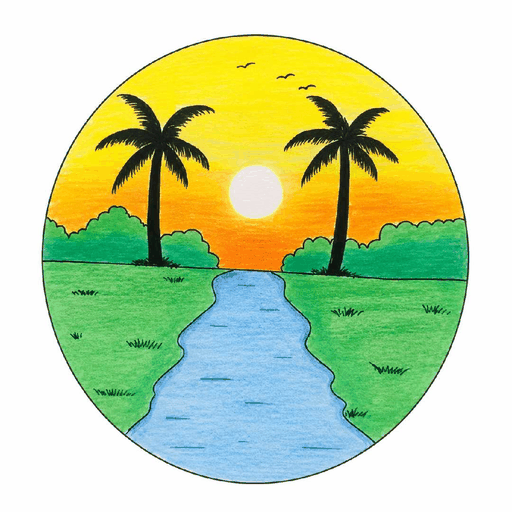

<!DOCTYPE html>
<html lang="ar" dir="rtl">
<head>
<meta charset="UTF-8">
<meta name="viewport" content="width=device-width,initial-scale=1,maximum-scale=1,user-scalable=no">
<meta name="theme-color" content="#07111f">
<title>Photos - Alislamiah</title>
<link rel="icon" href="icon.png">

</head>

<body>

<!-- SPLASH -->

Alislamiah

<!-- APP -->

<header class="topbar">

<strong>Photos</strong>
<small>by Alislamiah</small>

<button class="icon-btn" onclick="openSearch()" title="Search">⌕</button>
<button class="icon-btn" onclick="toggleMenu()" title="Menu">☰</button>

</header>

<main class="content">

<section id="homePage">

<h1>صورك، في مكان واحد.</h1>

مرحباً بك في Photos by Alislamiah

⌕
<input id="searchInput" type="search" placeholder="ابحث عن صورة أو فيديو...">

▧

<strong id="photoCount">0</strong>
<small>الصور</small>

▷

<strong id="videoCount">0</strong>
<small>الفيديوهات</small>

♡

<strong id="favoriteCount">0</strong>
<small>المفضلة</small>

<h3>أضف الصور والفيديوهات</h3>

اختر الوسائط من جهازك لعرضها هنا

<button class="primary-btn" onclick="document.getElementById('filePicker').click()">＋ إضافة</button>

<input type="file" id="filePicker" accept="image/*,video/*" multiple hidden>

<h2 id="sectionTitle">أحدث الوسائط</h2>
0 عنصر

<button class="active" data-filter="all">الكل</button>
<button data-filter="image">الصور</button>
<button data-filter="video">الفيديوهات</button>
<button data-filter="favorite">المفضلة</button>

</section>

<!-- ALBUMS PAGE -->
<section id="albumsPage" style="display:none">

<h1>الألبومات</h1>

اكتشف مجموعات الصور والفيديوهات الخاصة بك

</section>

<!-- FAVORITES PAGE -->
<section id="favoritesPage" style="display:none">

<h1>المفضلة ♡</h1>

الوسائط التي قمت بحفظها في المفضلة

</section>

<!-- SETTINGS PAGE -->
<section id="settingsPage" style="display:none">

<h1>الإعدادات</h1>

إدارة تطبيق Photos

<strong>الحساب</strong><small id="accountEmail">...</small>

<button onclick="toggleMenu()">عرض</button>

<strong>التخزين المحلي</strong><small>الوسائط محفوظة على هذا الجهاز داخل التطبيق</small>

▧

<strong>عدد الوسائط</strong><small id="settingsCount">0 عنصر</small>

▤

<strong>حول Photos</strong><small>Photos by Alislamiah</small>

ⓘ

<strong>المطور</strong><small>Alislamiah</small>

<strong>تسجيل الخروج</strong><small>الخروج من حسابك</small>

<button onclick="logout()" style="background:#a52d3a">خروج</button>

</section>

</main>

<nav class="bottom-nav">
<button class="nav-btn active" data-page="homePage">
⌂الرئيسية
</button>
<button class="nav-btn" data-page="albumsPage">
▦الألبومات
</button>
<button class="nav-btn" data-page="favoritesPage">
♡المفضلة
</button>
<button class="nav-btn" data-page="settingsPage">
⚙الإعدادات
</button>
</nav>

<!-- VIEWER -->

<button onclick="closeViewer()">×</button>
<strong id="viewerTitle">Photos</strong>
<button onclick="toggleCurrentFavorite()" id="viewerFavorite">♡</button>

Photos by Alislamiah

<!-- SIDE MENU -->

<strong>Photos</strong><small style="display:block;color:#8299b6;font-size:11px">Alislamiah</small>

<strong id="menuName">User</strong>
<small id="menuEmail">...</small>

<button class="menu-item" onclick="goPage('homePage');toggleMenu()">⌂ الرئيسية</button>
<button class="menu-item" onclick="goPage('albumsPage');toggleMenu()">▦ الألبومات</button>
<button class="menu-item" onclick="goPage('favoritesPage');toggleMenu()">♡ المفضلة</button>
<button class="menu-item" onclick="goPage('settingsPage');toggleMenu()">⚙ Settings</button>
<button class="menu-item" onclick="logout()" style="color:#ff8585">↪ تسجيل الخروج</button>

</body>
</html>
